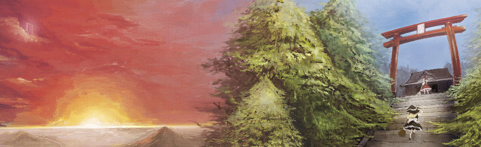

<p align="center">
  
</p>

<h1 align="center">Gensokyo Launcher</h1>

<p align="center">A polished desktop launcher for Touhou Project games on Windows and Linux.</p>

Gensokyo Launcher discovers games in a folder you choose, keeps launch settings organized in profiles, and provides a single place to manage native Windows and PC-98 Touhou titles. It does not include any games, disk images, BIOS files, or patches.

## Features

- Discover official Touhou games automatically from a selected parent folder.
- Launch Windows games natively on Windows or through Wine on Linux.
- Launch PC-98 Touhou 1–5 disk images through bundled Neko Project II/W.
- Manage per-profile display mode, resolution, language, and thprac settings.
- Install and use THCRAP language patches per profile.
- Install thprac practice tools per profile.

## Download

Download the latest platform package from the repository's **Releases** page:

- **Windows 10/11 x64:** `GensokyoLauncher-<version>-win-x64.zip`
- **Windows 7 SP1 x64 (best-effort):** `GensokyoLauncher-<version>-win7-x64.zip`
- **Linux x64:** `GensokyoLauncher-<version>-linux-x64.tar.gz`

Both standard packages are self-contained single-file .NET applications and do not require the .NET runtime. Linux still requires the normal desktop/X11 libraries provided by the distribution. On Linux, configure the Wine command under Settings if it is not simply `wine`.

## Windows 7 support (best-effort)

Windows 7 SP1 x64 is supported on a best-effort basis only; it is not a supported or security-maintained platform. The Windows 7 package runs on the self-contained .NET 6 runtime, the last .NET release that runs on Windows 7 SP1, which reached end of support in November 2024, so no .NET security updates apply to this build. Use the modern Windows package on Windows 10 and later.

In addition to installing the package, Windows 7 SP1 requires Microsoft's listed prerequisites, the Visual C++ 2015–2019 Redistributable and KB3063858:

- Visual C++ 2015–2019 Redistributable (x64): <https://aka.ms/vs/16/release/vc_redist.x64.exe>
- Security update KB3063858 (`Windows6.1-KB3063858-x64.msu`): <https://support.microsoft.com/help/3063858>

In addition, unsupported window backdrop effects fall back depending on the platform: Windows 10 and later support Mica and Acrylic, while on Windows 7 the launcher applies the classic Aero glass effect (DWM blur behind) when Aero is detected as the desktop composition theme; without Aero, or on Windows 8/8.1, windows use an opaque backdrop.

The launcher downloads THCRAP, thprac, and Neko Project II/W into the current user's local application-data directory when needed. Game files, BIOS files, and patches are never bundled or downloaded by the project.

## Build from source

### Requirements

- .NET 10 SDK
- Windows or a Linux desktop environment
- Wine on Linux for launching Windows game executables

Restore, build, test, and run the launcher with:

```sh
dotnet restore
dotnet build -c Release
dotnet test -c Release
dotnet run --project src/GensokyoLauncher -c Release
```

### Publish self-contained packages

Windows 10/11 (x64, .NET 10):

```sh
dotnet publish src/GensokyoLauncher/GensokyoLauncher.csproj \
  -c Release -f net10.0 -r win-x64 --self-contained true \
  -p:PublishSingleFile=true \
  -p:IncludeNativeLibrariesForSelfExtract=true \
  -o artifacts/GensokyoLauncher-win-x64
```

Linux x64 (.NET 10):

```sh
dotnet publish src/GensokyoLauncher/GensokyoLauncher.csproj \
  -c Release -f net10.0 -r linux-x64 --self-contained true \
  -p:PublishSingleFile=true \
  -p:IncludeNativeLibrariesForSelfExtract=true \
  -p:InvariantGlobalization=true \
  -o artifacts/GensokyoLauncher-linux-x64
```

Windows 7 SP1 x64 (best-effort, self-contained .NET 6):

```sh
dotnet publish src/GensokyoLauncher/GensokyoLauncher.csproj \
  -c Release -f net6.0 -r win-x64 --self-contained true \
  -p:PublishSingleFile=true \
  -p:IncludeNativeLibrariesForSelfExtract=true \
  -o artifacts/GensokyoLauncher-win7-x64
```

Then zipped, the Windows 7 output is released as `GensokyoLauncher-<version>-win7-x64.zip`.

Restore the executable bit after copying the Linux binary between filesystems:

```sh
chmod +x artifacts/GensokyoLauncher-linux-x64/GensokyoLauncher
```

## Game files

Point the launcher at a parent directory containing your legally obtained Touhou installations. PC-98 games should remain in their own directories with their disk images and accompanying configuration files. The launcher does not redistribute copyrighted game data.

## Contributing

Issues and pull requests are welcome. Please include your operating system, launcher version, game identifier, and relevant launch/profile settings when reporting a problem. Do not attach copyrighted game files or BIOS images.

## Credits

- Touhou Project — ZUN / Team Shanghai Alice
- THCRAP — Touhou Patch Center contributors
- thprac — Touhou World Cup and thprac contributors
- Neko Project II/W — Neko Project II contributors
- UI framework — Avalonia UI

Gensokyo Launcher is an unofficial fan project and is not affiliated with or endorsed by Team Shanghai Alice.
